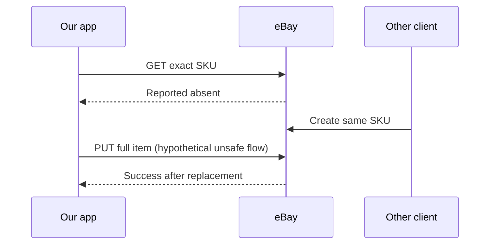
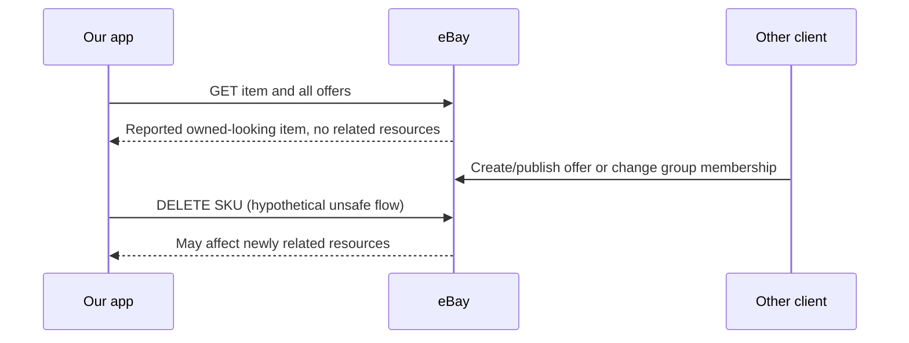
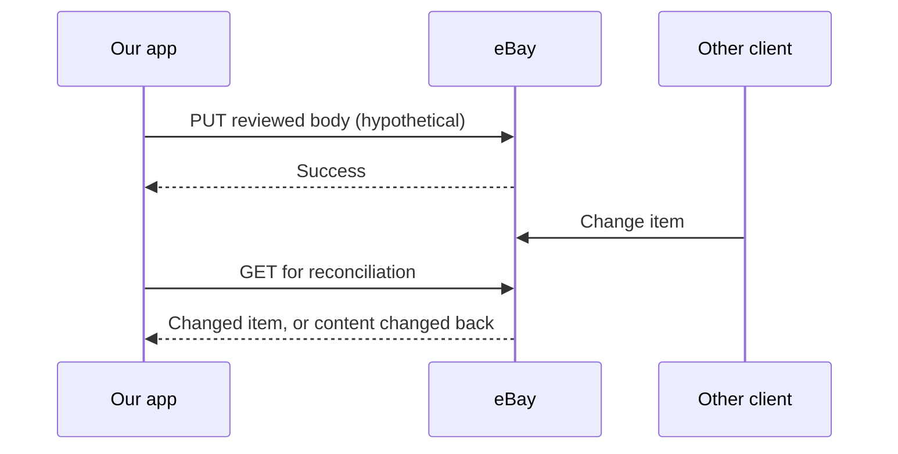
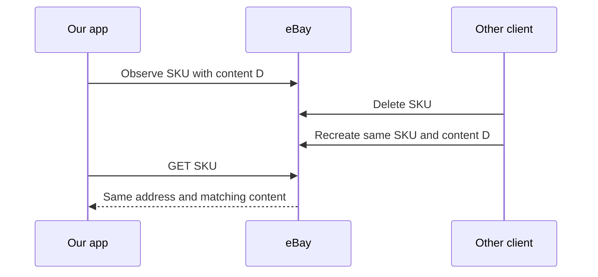

# Proposed Inventory ownership, history and cleanup

**Design only — November 18, 2026.** Baseline: PR #25 merge `068de92c65a1ede2f487cf03f66c0737c31471e6`, with actual post-merge Validate green. The [merged pure planner](ebay-inventory-planner.md) compares supplied observations; it does not authenticate them or persist ownership. All `canStage`/`canDelete` values remain false. Real EPS transport/admission and Inventory staging/deletion remain disabled. Nothing below is an implemented schema, approved retention policy, provider experiment or permission to send.

## Recommendation and decision gates

**Initial policy: NO-GO for automatic Inventory PUT and DELETE.** Build only separately approved persistence and fake/read-only observation boundaries first. Refuse existing-item replacement/adoption, automatic retries and SKU reuse. A durable local claim can coordinate this application; it cannot prove that an upsert created a resource or exclude another eBay client. Manual review produces an owned private residual record, not an override that enables a write.

Before any real write design can be enabled, obtain a documented mechanism that supplies the required creation/incarnation and deletion assurances, or separately review a materially different risk policy. No seller-exclusivity checkbox, operator flag, special SKU prefix, local lock or matching-body shortcut satisfies that gate. Completing this design does not require solving those provider limitations.

## Dated contract evidence

Sources checked on November 18, 2026:

- **C1:** [Public Inventory OpenAPI](https://developer.ebay.com/api-docs/master/sell/inventory/openapi/3/sell_inventory_v1_oas3.json), downloaded `info.version=1.18.5`, SHA-256 `070e35efbc1e6b0c67c702d3bd9d8a4fb5046bcd948dca7170f1bc33d5a36a46`. Relevant paths and schemas are identified below, not treated as authenticated observations.
- **C2:** [Managing inventory items](https://developer.ebay.com/api-docs/sell/static/inventory/managing-inventory-items.html), independently describes full replacement and SKU-based reads/deletion.
- **C3:** [New release index](https://www.developer.ebay.com/develop/api/inventory-api/release-notes) lists **1.18.8**, while the [legacy release index](https://developer.ebay.com/api-docs/sell/inventory/static/release-notes.html) and C1 still show **1.18.5**. The newer entries describe condition/aspect changes and an apparel/footwear error; they do not by themselves establish unchanged method contracts. New method-page links resolved to the general Inventory page in this review. **Current-version parity is unresolved**, not silently inferred from HTTP 200 or an old specification.
- **C4:** [Release archive](https://developer.ebay.com/api-docs/sell/inventory/static/release-notes-archive.html) records `sku`/`groupIds` moving out of `InventoryItem` when reads adopted `InventoryItemWithSkuLocaleGroupid`. This is a **type-specific change**, not evidence that `groupIds` disappeared from GET responses; C1 still includes it in that response type.

| Area | Documented in the inspected source | Existing evidence / proposed safeguard | Unresolved assurance |
| --- | --- | --- | --- |
| Exact item | C1 `GET /inventory_item/{sku}` returns a SKU-addressed item; C2 agrees. | Validate exact SKU and seller-bound context; classify errors separately. | No provider incarnation token or app provenance established. |
| Upsert | C1 `PUT /inventory_item/{sku}` and C2 describe complete replacement; related listings can change. | Initial policy refuses every existing SKU. | Absence then PUT is not conditional creation. |
| Offers | C1 `GET /offer` with SKU, optional format/marketplace filters, pagination and listing details. | Omit both filters; prove collection completeness or report unknown. | No atomic snapshot or universal cross-API listing coverage established. |
| Groups | C1 exact-item schema includes `inventoryItemGroupKeys`/`groupIds`; known-key group GET exists. | Any membership blocks; omission is only a qualified point-in-time observation. | Current-version semantics and concurrent membership remain unverified. |
| Delete | C1 DELETE describes effects on unpublished offers, single-variation listings and groups. | Require provenance and related-state evidence; retain NO-GO. | No atomic check-and-delete documented. |
| Preconditions | C1 PUT/DELETE declare no conditional headers or app ownership field. | No conditional-write/delete implementation is assumed. | Unlisted behavior is not proof of impossibility or support. |

No real Inventory Item/offer/group acceptance has been performed. Earlier seller-readiness tests read account/location data, not this lifecycle. Reverb SKU reconciliation and synthetic media receipts do not establish eBay Inventory ownership.

C1 has additional ambiguities: `getOffers.sku` is marked optional in parameters but described as required elsewhere; `offset` is described as a page number, while `next` supplies navigation; the default page-size prose and `offers` maximum-occurrence annotation differ. It also lists multiple PUT success statuses without a proven per-incarnation provenance contract. **Do not select one interpretation or treat a particular success status as ownership.** Obtain a consistent current contract before a real adapter. A source search finding no `If-Match`, `If-None-Match`, ETag or idempotency parameter is evidence about C1 only, not a platform-wide guarantee.

### What absence could mean

An unfiltered, fully validated SKU-scoped offer collection can support “no Inventory offers reported during this read interval,” subject to its contract/version and mutation limitations. It does not establish eternal absence, exclude independently managed listings in other eBay models, or reserve anything. Any returned offer blocks initial staging/cleanup, regardless of publication state. Published-offer listing details identify a related listing; missing or contradictory required details are unknown, not unpublished.

C1 says group-reference arrays are omitted when the item has no group association. A future version-pinned parser may report **no membership reported at this item read**, after validating the complete item response and resolving the response-type/field contract. A present group reference blocks; malformed/null, conflicting fields or an incompatible contract version remain unknown. There is no invented all-groups endpoint. Known-key group reads can inspect reported membership under a separately bounded read action; they cannot prove that no other group exists. Related-listing state remains unknown when offer coverage, item state or the cross-model guarantee is unresolved.

## Identity and ownership evidence

Keep these identities distinct:

| Identity | Meaning |
| --- | --- |
| Canonical Listing ID | Local product aggregate, owner-scoped; not a remote resource ID. |
| Deterministic SKU | Existing `ebaySku(listing.id)`; exact lower-case application format, at most 50 characters. Naming is not ownership. |
| Seller principal + environment + SKU | Remote Inventory Item address. No separate immutable provider incarnation ID was established. |
| Local resource ID / local epoch | Ledger identifiers only; an incremented local epoch does not identify a new eBay incarnation. |
| Connection ID/version | Current authorization binding, not resource identity. Reconnect cannot allocate a new ownership namespace. |
| Future Offer ID / published Listing ID / group key | Independently validated related identities; never substituted for SKU or for one another. |

Use the existing verified stable seller identity and identity-contract version from the server connection, never a display name, opaque-token decoding or browser ID. A future identity-contract migration must preserve/review the seller-principal crosswalk before claims resume; changing a version/hash must not bypass existing history.

| Candidate evidence | What it establishes | Ownership admission |
| --- | --- | --- |
| Authenticated owner/session and verified seller identity | Authority to request a bounded app action for that seller. | Necessary, insufficient. |
| Unique local seller/SKU claim and consumed confirmation | This app's local coordination and intent. | Not remote ownership. |
| SKU prefix, exact title/body/media/payload digest | Correlation/content similarity. | Never adoption or deletion authority. |
| Preflight absence + successful upsert + matching readback | Ordered observations and a response to an intended request. | Race may have overwritten another client's item; insufficient. |
| Prior app acknowledgement followed by an observation gap | Historical request evidence. | Does not distinguish delete/recreate with identical content. |
| Human assurance that only this app uses the seller | Governance assertion; other grants, UI or clients may still act. | No automatic exception. |
| Future documented, validated creation/incarnation evidence with enforceable predicates | Could establish specifically defined historical provenance. | Requires a new reviewed admission contract; none is available here. Current mutation safety is a further gate. |

**This design admits no current real `confirmed` ownership record.** Store unproven/conflicting observations and local claims honestly. The planner's synthetic `ownership.state="confirmed"` is not an evidence issuer. Do not set it from a success response or an operator boolean. Future provenance admission would need a separate contract, implementation and review, not a configurable name in this design.

A future admission contract would have to establish **all** of: the authenticated seller/local initiating owner; an enforceable create-only predicate rather than upsert; an acknowledgement binding that request to a distinguishable provider incarnation; and a current observation of that same incarnation. Cleanup would additionally require an enforceable predicate excluding related-resource changes at deletion. No present source supplies that conjunction. Historical provenance alone would still not establish current deletion safety.

## Proposed minimum durable model

Three evidence tables plus a detachable current-product projection are sufficient; no job infrastructure or broad marketplace framework. Names below are proposed, not migrations. Use finite UTC timestamps, nonnegative monotonic revisions, bounded enums/strings and composite owner/resource references. Proposed caps are application budgets, not claimed eBay limits.

| Record | Proposed fields and constraints | Lifecycle |
| --- | --- | --- |
| `inventory_resources` | Internal UUID; Sandbox environment; stable seller principal/identity version; exact SKU; immutable claiming owner; historical listing reference; local epoch; revision; local-claim/provenance classification; safety-hold and current-evidence references. **UNIQUE(environment, seller_principal, sku)** independent of connection, owner, recipe and local epoch. Owner FK RESTRICT pending offboarding approval. | Retained namespace/tombstone anchor. No cascade from product or connection. Claim ownership is local only. |
| `inventory_attempts` | UUID, resource/owner references; operation `inspect`, `initial-stage` or `cleanup`; one-use action/session hashes; complete captured version/fingerprint tuple; claim hash/lease/revision; state/reason; immutable intent timestamp and payload/media-manifest digest when applicable. **UNIQUE(owner, action_hash)** unconditional across operations/history; one active unfenced mutation claim per resource, enforced transactionally/indexed. | Old attempts survive reclamation and deletion. Intent is never erased or turned back into a preparable attempt. |
| `inventory_evidence` | UUID, attempt/resource/owner composite references; kind (`item-read`, `offers-page`, `group-read`, `write-ack`, `absence`, `conflict`, `local-retirement`); contract/canonicalization version; request interval/status/failure code; bounded normalized facts/digests and coverage; fingerprint. **UNIQUE(attempt, fingerprint)**. | Append-only observations, acknowledgements and tombstones. Conflicts accumulate; newer evidence does not overwrite them. |
| Current-product projection | Optional owner-scoped link to resource plus listing/connection version, last observation and safe summary. Composite ownership checks. Product/connection deletion may detach this link only. | Derived convenience, never provenance or a write grant. Rebuilt only with CAS and current context. |

Index attempts by `(resource_id, created_at, id)` and `(owner_id, created_at, id)`, evidence by `(resource_id, finished_at, id)` and attempt/fingerprint, and unresolved intent/hold by `(environment, seller_principal)`. Maintain the global seller/SKU uniqueness check even if the claiming owner disconnects or a listing is deleted. A unique claim may fail with a generic “requires manual resolution”; do not reveal another app owner's listing, evidence, IDs or existence details.

A short seller-scoped transaction/guard must serialize local resource claims and unresolved-intent checks across **all app owners connected to that seller**. A proposed PostgreSQL transaction advisory lock uses a stable hash of environment/seller principal, not connection/owner; collisions only over-serialize. All cooperating repository transitions use the same guard, with defensive state constraints; a process-local mutex is insufficient. One unresolved mutation/conflict places a conservative seller-level write hold, including for new local IDs/SKUs; it is not a hold on independent read-only inspection. New listing IDs or reconnects cannot hide that hold. Different genuinely new items may share content, so **do not copy media's seller/content-digest uniqueness rule** onto Inventory units. Do not transfer claims between owners automatically; account recovery/transfer requires a separate private reviewed procedure.

Use SQL constraints/triggers in a future implementation for immutable intent bindings, unconditional action uniqueness, nondecreasing revisions, valid transitions, append-only evidence and prohibited fenced-row deletion/truncation. Store the current link separately so ordinary local deletion can detach it without losing history. Do not rely on TypeScript checks alone. These protections do not withstand an administrator changing DDL.

### Privacy and retention proposal — approval required before migration

Persist only the necessary pseudonymous seller key, opaque local/remote identities, context versions, operation/status codes, intervals, coverage facts and content/evidence digests. Pseudonyms remain linkable personal data, not anonymization. No tokens/codes/cookies, credentials, private paths, original filenames, image bytes, signed capabilities, raw provider responses or copied account/profile data. Avoid storing title/description or full request bodies; reconstructed provider data is held only within a bounded operation. A payload digest is not a proof of who wrote it.

Proposed budgets: identifiers at most 200 characters (SKU 50), a normalized evidence envelope at most 64 KiB, and 250 offer references per inspection. Over-budget data becomes incomplete/unknown. Do not persist provider pagination URLs; retain validated cursor/coverage facts, not arbitrary links. These budgets require compatibility tests before an adapter is implemented.

Listing/image/connection deletion detaches current links and cancels local preparation; **attempts, consumed actions, intent fences, seller/SKU anchors and tombstones survive**. Connection tokens remain in their existing encrypted store; Inventory evidence never duplicates them. Local photos keep the existing retention/cleanup lifecycle; an Inventory tombstone is not a reason to retain image bytes forever. Account deletion must not silently cascade evidence away.

Recommend a **30-day post-resolution review horizon for detailed normalized diagnostic evidence**, retaining only the minimum action/resource/intent/tombstone facts needed to prevent unsafe reuse while the integration is enabled. This is a proposed minimization target, not an approved deletion promise or indefinite-retention policy. Unresolved cases and owner offboarding require an explicit retention/deletion decision, reviewed lawful purpose and a deadline. If legally required deletion removes safety evidence, freeze further writes for that namespace; do not purge it and treat it as new. Approval of durations, RESTRICT/offboarding behavior, erasure handling and residual reporting is required before any production migration. No automatic purge or indefinite retention is authorized here.

## Claims, intent and acknowledgement rules

Confirmation is unpredictable, short-lived, one-use and bound to authenticated owner/session, operation, resource, captured resource revision, canonical listing/version, stable seller/identity contract, connection/version, exact grant/configuration fingerprints, metadata contract, allowed payload digest and ordered approved-media manifest. Never accept a browser-provided SKU, host, delete URL, ownership flag or payload digest as authority. Different operations need different confirmations.

Proposed local timings: five-minute review validity and a 60-second unfenced claim lease, measured by trusted server/database time with explicit clock inputs in tests. They are not provider reservations. Canonical plan identity hashes a versioned allowlist with deterministic object-key ordering, declared aspect-value ordering and persisted photo order; it excludes Offer/private fields. A separate SHA-256 identifies the **exact final UTF-8 request bytes** before any hypothetical intent, with context/media-manifest fingerprints bound alongside it. No real final payload exists until URL/media admission is reviewed. Readback comparison uses a separately versioned semantic normalization, not provider JSON byte equality; unhandled fields/transformations become unknown/conflict. None of these hashes proves ownership.

Use a reviewed cross-repository lock order; a candidate is seller guard → owned listing → connection → ordered images → resource → attempt → live session. Check it against existing media/product locking before implementation; do not nest repositories or hold one transaction across external work. Product detachment must not introduce the reverse lock order.

1. Claim in a short transaction with resource/version and owner checks. An expired **unfenced** claim is retired `not-sent` by ID/revision/claim-hash CAS; a fresh action inserts a new attempt ID/token/revision zero in the same transaction. Preserve the old action row. Failure rolls both changes back. Old A cannot move to another listing/resource B, and stale A cannot fence, acknowledge as the new worker or retire a replacement.
2. A definitive pre-intent cancellation/validation failure can be recorded `not-sent`. A fresh explicit action may prepare again only if no unresolved resource/seller hold exists. Absence or matching content never consumes/clears another action's history.
3. A hypothetical write fence commits intent and all reviewed bindings **before** any request. A lost commit acknowledgement means stop and read the local attempt; it is never permission to send. Fence expiry, lease expiry, a new review, edit, reconnect or deletion cannot release it. The current NO-GO policy never reaches this step against a real provider.
4. Once intent exists, crash/cancellation/deadline/network failure is conservatively uncertain, even if a worker believes it had not sent bytes. No replacement lease can re-send. A successful response is a transport observation, not creation provenance. HTTP PUT's idempotent classification does not make repeated whole-item replacement safe against intervening edits.
5. Append normalized acknowledgements with an attempt-bound fingerprint in a short transaction. An identical **local DB acknowledgement** may be retried after a lost response/commit; it performs zero provider I/O and cannot start another attempt. Different/contradictory evidence remains appended and holds the resource. Late/stale results may record private residual evidence for their original attempt only; they cannot activate a current link.

Existing [media persistence](ebay-real-media-persistence.md) supplies patterns for consumed-action preservation, CAS, short transactions and retained evidence. Its synthetic receipt contracts, source/derivative fences, admission states and photo-specific deletion rules are **not Inventory ownership rules** and are not copied as proofs.

## State transitions

Resource observation, transport intent/outcome and ownership are separate dimensions. “Confirmed observation” means a validated fact at an interval, not confirmed ownership or permanent absence. All tables below describe future behavior; current real writes stop at NO-GO.

### Initial staging

| From / event | Durable transition | Permission / recovery |
| --- | --- | --- |
| No local anchor; explicit preparation | Claim global seller/SKU anchor and new `preparing` attempt. | Local claim only. Validate actual metadata/media and current context. |
| Validation failure, cancellation or lease expiry before intent | Old attempt → `not-sent`; action binding retained. | New action may prepare, not auto-send. |
| Any existing remote item, related/unknown resource, stale input, unresolved prior intent | Append refusal/observation, `blocked` or `manual-review`. | No replacement/adoption; no reset by matching payload. |
| Fresh reported absence; local checks otherwise clean | Retain observations; `blocked-external-race`. | Current initial policy ends here, with no intent/PUT. |
| Future reviewed send admission, if ever established | CAS `preparing` → `intent-unknown`; immutable request/media/version binding. | Reserved design transition, not available through a boolean or this document. |
| HTTP response / subsequent read | Append `write-ack` and exact-item evidence; `response-observed` or `unknown/conflict`. | Even a success and matching item leave provenance unproven under the current contract. |
| Source/session/connection changes after hypothetical transmission | Retain original intent/evidence; current projection detached/stale. | Residual/manual resolution; no recall, retry or new-identity bypass. |

### Read-only reconciliation

| Observation/event | Durable result | Planner meaning |
| --- | --- | --- |
| Explicit authenticated inspection | New `inspect` action, captured resource revision and bounded read interval. | No write intent; no implicit token operation. |
| Complete, current, matching reported item | Append content-consistency evidence. | With current unproven provenance, keep `ownership=unproven`; the planner must still require manual review. Do not synthesize its `confirmed` input to obtain `consistent`. |
| Truly admitted provenance under a future reviewed contract plus matching current facts | Could append separate provenance/consistency evidence. | Only then might `consistent` be a valid projection; it still cannot authorize staging/deletion or defeat the external race. |
| Validated exact-item absence, complete related observations | Append `observed-absent-at-T` tombstone. | Describes that read only. Uncertain prior intent remains `priorWrite=uncertain`; do not coerce it into the planner's clean `observed-absent` path. |
| Mismatch, coverage gap, conflicting evidence or stale revision | Append scoped conflict/partial evidence; no newer projection overwritten. | Manual/unknown; no adoption or resend. |
| Inspection crash/lost local acknowledgement | Preserve unfinished attempt; retry only an identical local evidence acknowledgement if available. | No automatic network retry; another explicit inspection is a separate bounded action. |

### Cleanup

| Observation/event | Durable result | Remote behavior |
| --- | --- | --- |
| Explicit cleanup review without adequate provenance/current complete state | Record refusal and private residual summary. | No DELETE. Expired photos and local deletion confer no authority. |
| Reported provenance and fresh no-offers/no-listings/no-groups checks | Preserve evidence and `blocked-external-race`. | Current policy still refuses automatic DELETE. |
| Separately approved future conditional-safe cleanup, if established | New one-use cleanup action and immutable intent fence. | At most its separately approved one DELETE; not enabled here. |
| Lost DELETE reply, timeout, 5xx, cancellation or uncertain commit | Retain `cleanup-unknown`. | Never repeat DELETE blindly. A later explicit read does not itself permit another deletion. |
| DELETE response followed by validated absence | Append acknowledgement and time-bounded absence tombstone. | Not proof of perpetual absence, exclusive causation or permission to reuse SKU. |
| Item present after delete/absence, including matching content | `incarnation-ambiguous`/conflict and retained residual. | May be a replacement by another client. Never delete again or adopt it. |

Observed absence can resolve a **displayed residual-at-check** separately from transport/provenance uncertainty. It cannot erase an intent, consumed action, seller hold or historical ownership gap. Releasing a hold/reusing a SKU requires a future reviewed evidence policy; no reset API is proposed in the first slice.

## External-client races

### Absence followed by destructive upsert

Local locks exclude cooperating app transactions only. A digest identifies our intended content; the response/readback cannot establish that we created rather than replaced the item. A long random SKU lowers collision probability, not this assurance requirement. **NO-GO** unless an enforceable provider-side predicate or a separately reviewed different policy exists.

### Clean checks followed by dangerous deletion

Fresh checks and a human confirmation do not make the condition atomic. Prior provenance, even if someday established, does not exclude later offers/groups. There is no accepted conditional DELETE mechanism here. **Refuse automated cleanup** and retain a private manual-resolution record.

### Change between write and readback

Different content is conflict. Matching content can also follow an external change-and-restore; digest equality is neither causal proof nor a continuous version history. Never automatically repair with another PUT. Readback is an observation, not a lock or a creation certificate.

### Same-SKU recreation (ABA)

Neither local epoch nor content hash distinguishes these incarnations. Even a prior acknowledged delete and later absence cannot reserve the address. Keep the seller/SKU anchor/tombstones; initial policy **does not reuse a retired SKU**. A new canonical ID/connection cannot clear an old unknown outcome or seller hold.

### Alternatives considered

| Alternative | Benefit | Enforcement limit / decision |
| --- | --- | --- |
| Fresh reads + local lock + random SKU | Reduces accidental collision and local concurrency. | No remote atomicity; insufficient. |
| Seller-exclusive operating agreement | Could reduce outside activity operationally. | Cannot disable seller UI, other grants/imports or forgotten clients. Not a supported technical guarantee or an accepted boolean bypass. |
| Provider conditional creation/deletion and durable incarnation evidence | Could enforce specifically documented predicates. | Not established by the reviewed sources. Require authoritative contract and tests, not assumed ETags. |
| User manually manages the remote resource | Avoids this app autonomously overwriting/deleting. | Human mistakes and outside races remain; record residuals without claiming safe automatic cleanup. |
| Stay local/read-only and implement falsifiable ledger tests first | Preserves existing behavior while exposing evidence gaps. | **Recommended initial policy.** No real staging/deletion until new assurance/risk review. |

## Future observation and orchestration boundary

Every future provider operation requires separate implementation/authorization. Plain rendering, navigation and ordinary Save read local state only. A prior review or stored `consistent` label never triggers traffic.

### Establishing normalized observations

1. Authenticate the app session, derive owner server-side and load its owned listing/current connection. Revalidate stable seller, Sandbox environment, exact grant/profile, configuration, session and resource versions. If expired/insufficient authorization, stop; no implicit refresh/consent to complete an inspection. No arbitrary host, path, SKU or token from browser input.
2. A future pinned client uses only documented Sandbox API paths. Exact-item GET must return the requested SKU under the bound seller. Validate status, JSON/content type and bounded relevant fields. A verified method-specific not-found response can mean absence at that read; generic 404, 401/403, redirect, malformed response, 429, timeout or 5xx is not absence. Refuse automatic retries.
3. For offers, request the **exact SKU without marketplace or format filters**. Parse every page and per-offer SKU/ID/state/listing reference. Validate `next` against pinned origin/path/query, reconstruct a fixed request rather than following an arbitrary URL, reject cycles/filter changes, duplicates/contradictions, missing pages or changing totals. Do not invent `offset += limit`: resolve C1's pagination ambiguity before a real adapter. Exhausted budgets or unresolved pagination semantics yield incomplete/unknown, even with zero collected offers.
4. A proposed inspection budget is 25 offers/page, 10 pages/250 offers, 1 MiB decoded body/request, 10 seconds/request and 60 seconds/inspection. These are local safety proposals, not provider maxima. Freshness runs from the **oldest request start**, with every request interval retained; expiry is the earliest applicable review/token/context deadline, at most 60 seconds from that start. A result already expired on completion is unusable. Multi-request data is never called an atomic snapshot. Known group references cause refusal; an optional diagnostic group read needs its own explicit budget.
5. `offers.complete` requires a current consistent contract plus validated termination, counts and unfiltered coverage. `groups=none` needs the exact-item contract/omission rule reconciled with response-type differences; `listings=none` needs adequate listing coverage, not just a non-published local flag. Cross-model listing gaps stay `unknown`. Append bounded coverage evidence; do not manufacture empty collections after failures.
6. Commit observations in a short owner/resource-scoped transaction comparing captured revision and current context. Older results can append scoped historical evidence but cannot replace newer identity/state or clear holds. Encrypted credentials stay in the connection store and out of evidence/browser/logs. Store no raw responses or authorization data.

### Staging sequence under the initial policy

Session → local owned snapshot/claim → validate metadata and **actually admitted** ordered media → explicitly authorized bounded observation adapters → short evidence/CAS commit → pure planner + preflight → **NO-GO/manual resolution**. No intent/PUT is issued. Fake media observations cannot satisfy the real-media gate. If a later contract permits a write, it needs a new design review for the exact bytes, grant, one-use confirmation, durable fence and pre-send guard; this document supplies no active admission path.

The ordered media manifest would bind image/order, source-version and source/final-byte identities, recipe, admitted receipt/association identity and expiry through the approved operation margin. URLs/capabilities are not browser review fields. Real admission is still closed, so this manifest cannot currently be produced for real staging.

### Reconciliation sequence

Explicit check → session/owner/seller/resource snapshot → bounded exact-item/offers and qualified group observations outside DB → short append-only evidence commit plus latest-revision CAS → safe summary. Planner inputs are derived from those records, not copied from submitted `confirmed`, `complete` or `canStage` flags. Under this evidence model use `ownership=unproven`; a matching uncertain upsert never becomes proven creation. No GET creates credentials, claims a foreign resource or schedules a retry.

### Cleanup/manual-resolution sequence

Explicit cleanup review → owned resource and historical provenance check → fresh complete related-state evidence → **NO-GO if provenance, coverage or external race is unresolved**. Return only a safe failure category in UI. A private owner-authorized residual report can contain resource reference, exact SKU, environment, seller pseudonym, relevant observed Offer/Listing/group references, intent/outcome timestamps and reasons; no tokens, URLs, raw responses, account profile or another app owner's records. A human may choose action on eBay separately; this app does not send it or promise safety. A later explicit observation records the result without purging history.

Local listing/photo/connection deletion never calls Inventory DELETE. Remote cleanup never deletes local photos or disconnects the intended account. Token revocation, media expiry and user cancellation do not erase a hypothetical transmitted effect. No remote erasure guarantee is promised.

### Failures, cancellation and database outages

- No network or native processing while a transaction/row lock is open. Required source retention and local claims commit first; actual byte work stays within existing separate media boundaries.
- Cancel before intent: retire only the exact claim by CAS. Cancel after intent: stop new work, bound/abort the owned request, retain uncertainty until its actual settlement; abort is not proof the provider did nothing. Do not release capacity while an owned request/native operation is still settling.
- DB unavailable before claim/intent: no provider mutation. Ambiguous fence commit: stop. Provider response followed by DB failure: no second request; bounded normalized evidence may be locally acknowledged later if still available, otherwise retain unknown. Never create an unapproved plaintext response spool.
- Auth failure/revocation, unexpected seller/environment, rate limiting, parser/byte/deadline failure or stale binding stops the operation. No fallback host, scope expansion or weakened parser. Safe summaries expose state/reason/check time only; private diagnostics are owner-scoped and separately bounded.

## Future verification matrix — tests not implemented here

| Boundary | Unit / fake-provider cases | Disposable PostgreSQL / browser cases |
| --- | --- | --- |
| Identity/provenance | Name/body equality cannot produce ownership; success/upsert/readback insufficient; identity-contract migration cannot open a namespace. | Two owners/same seller compete for one SKU with generic refusal; distinct sellers isolated; reconnect/new IDs retain holds. |
| Claims/action history | Expired unfenced A replaced by B then C; A cannot claim another resource or mutate B/C. | Unconditional consumed-action uniqueness, concurrent claimants, retirement+insert rollback, stale tokens/revisions, owner authorization and global seller guard. |
| Fence/crashes | Every cut before/after intent, transport entry, response and commit; no network retry from lost local acknowledgement. | Immutable intent/context, one unresolved mutation hold across IDs/owners, no reset by expiry/edit/disconnect/deletion. |
| Reads/pagination | Exact SKU, two formats, filters refused, `next` cycles/foreign URLs, changing totals, duplicate/partial/empty pages, wrong seller/environment, malformed/null/group omission/type-specific contradictions. | Captured-revision CAS prevents stale overwrite; owned safe projection; 401/403/404 classification, 429/timeouts/size limits, no hidden token operation. |
| External interleavings | Absent→external create→PUT; clean→offer/publish/group→DELETE; write→external edit→read; delete/recreate identical SKU/body. | Fake outcomes cannot admit provenance or release holds; foreign resources untouched; all current decision permissions stay false. |
| Acknowledgement/conflict | Identical local ack repeats safely; contradictory statuses/content retained; late result bound to original attempt. | Unique evidence fingerprints, lost commit acknowledgements, append-only SQL protections, no fenced-row delete/truncate, no admin-proof claim. |
| Cleanup/residuals | Missing ownership or coverage, expired media, uncertain DELETE and later absence/presence; never repeat DELETE or reuse tombstoned SKU. | Product/image/connection deletion detaches only current links; retained actions/tombstones; local photos and intended encrypted connection survive remote-cleanup actions. |
| Review/privacy/UI | One-use operation-specific confirmations, session/grant/config/order/version changes, media admission closed and URLs absent from DTOs. | Explicit fake-only actions, decline/cancel/stale review, zero navigation/Save traffic, no browser storage/log credentials or raw provider data; offboarding refusal until policy approved. |

All future tests use synthetic identities/content and disposable DBs; fixtures must label provider behavior as simulated. Positive consistency/absence controls do not prove atomicity or real ownership. A passing fake transport suite never enables real transport.

## Separately reviewable next slices and open approvals

| Slice | May be proposed against fakes | Gate before implementation/enabling |
| --- | --- | --- |
| 1. Minimal local resource/action/evidence persistence | Constraints, consumed-action reclamation, append-only acknowledgement, tombstones and generic cross-owner conflicts; no provider gateway. | Approve this design's minimum fields, seller-wide holds, deletion/offboarding and retention policy. Do not call claims remote ownership. |
| 2. Bounded read adapters + projection | Exact-item/offer/group parsing, pagination, interval freshness and owner/revision CAS with loopback fakes. | Reconcile current 1.18.8 versus legacy C1, pagination/status/group/listing coverage and error semantics. Real authenticated reads need separate approval. |
| 3. Fake-only orchestration/refusal path | One-use review, claimed snapshots, failure cuts and the four external races, with **NO-GO** preserved. | Separately reviewed composition; no real media, scope or runtime entry point implied. |
| 4. Any real mutation or automatic cleanup | Not unlocked by the preceding slices. | Actual creation/incarnation/conditional-deletion assurance or separately approved changed risk policy; complete related-state coverage; real media contract/admission, write grant, privacy/resource limits and exact acceptance/cleanup budget. Currently blocked. |

Open owner decisions: proposed retention/offboarding terms and evidence budgets; seller-level hold granularity and private claim recovery; whether to authorize only slice 1 after independent review. Open contract questions: version parity, pagination/empty/error behavior, complete listing/group coverage, enforceable creation/deletion predicates and incarnation identity. No request is sent to support in this task. **This draft design does not approve any slice, migrate data or change the merged planner.**
