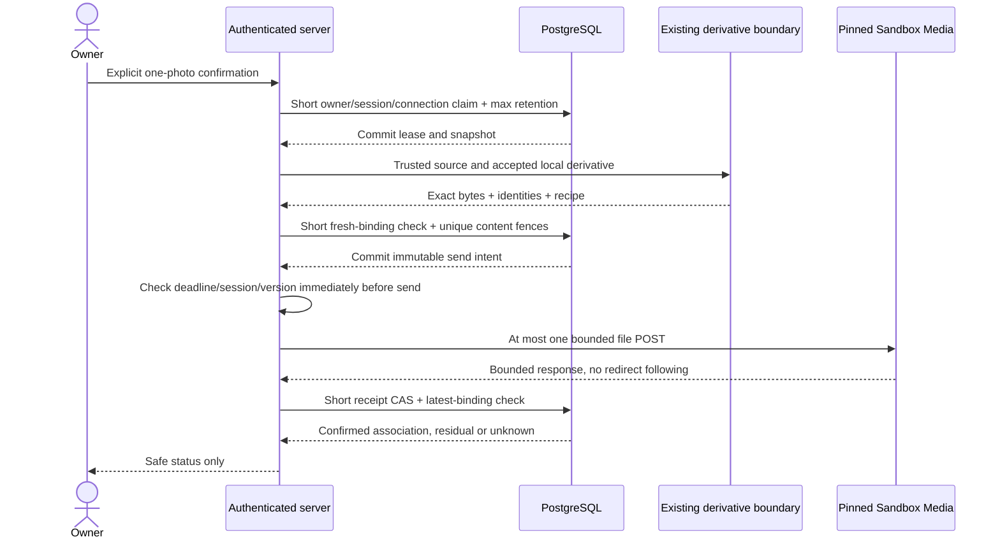

# Proposed real Sandbox media records and transfer

Design for review, 2026-11-16, against merged development baseline `b04159870a030d070b6d757c4187979feb92f69e`. **Documentation only; no real uploader, write authorization profile, real records or migration is implemented by this document.** Stage 9B remains In Progress; real EPS stays hard-disabled. The next implementation requires separate approval. Inventory, offers, publication, remote attachment, background synchronization and generic HTTP proxying are excluded.

## Evidence and current boundary

| Evidence class | Current conclusion | What it does not establish |
| --- | --- | --- |
| Implemented, merged PR #17 | [Local derivatives](photo-derivatives.md): session owner, durable private source/retention, accepted privacy classification, actual output inspection/full decode, separate digests, version guards and bounded native lifecycle | No browser entry point, provider consumer, real upload or provider compatibility |
| Implemented, merged PR #15 | [Simulation journal](ebay-private-media.md#attempt-and-response-foundation): fake-only schema/recipe/URLs, leases, pre-send fencing and residual evidence | No real records, URL grammar or remote recovery |
| Human Developer Support, summarized from private project records | Sandbox file creation uses `apim.sandbox.ebay.com`; success supplies JSON URL/expiration and Location identity; Sandbox `getImage` is unavailable | No exact Sandbox response example, EPS grammar, specific visual ingestion, exact limits or alternative recovery proof |
| Public [Media OpenAPI v1_beta.5.0](https://developer.ebay.com/api-docs/master/commerce/media/openapi/3/commerce_media_v1_beta_oas3.json), checked 2026-11-16 | File POST uses multipart `image`, 201/Location and ImageResponse fields; requires `sell.inventory`. Server entries and Location example are Production | No Sandbox origin/path substitution or idempotency contract |
| Public [Managing images](https://developer.ebay.com/api-docs/sell/static/inventory/managing-image-media.html) | EPS processing can change image size/compression; generic guidance describes URL/expiry and getImage | No Sandbox getImage permission, exact static-image limits or byte-preservation promise |
| Pending real Sandbox evidence | Actual returned URL structure, authentication/redirect behavior, marker ingestion, color/alpha and recovery | Neither support submission nor fake/decoder success is acceptance |

The [local privacy defaults](photo-export-privacy.md) are accepted and implemented. Real format/color/alpha compatibility remains unresolved. Current code anchors are the [internal server entry](../src/application/photoDerivativeServer.ts), [simulation SQL constraints](../src/infrastructure/db/ebayMediaSchema.ts) and [hard-disabled runtime](../src/infrastructure/ebay/mediaRuntime.ts). Private correspondence, ticket identifiers, account details and operational captures belong in existing private project records, not this public guide.

## Proposed records: three separate real tables

Names below are design names, not ORM definitions. Keep `ebay_media_attempts` and all simulation-only SQL/recipe/URL constraints unchanged. Never copy fake records into the real namespace or reinterpret `simulation=true`.

| Proposed record | Minimum fields and invariants |
| --- | --- |
| `ebay_real_media_attempts` | Random attempt ID; owner; literal `sandbox`; verified seller key and identity-source version; connection ID/version, configuration and exact grant-profile fingerprints; initiating session binding hash and explicit-action ID; listing ID/version, image ID/order, source-metadata fingerprint; source digest and final derivative digest; full bounded recipe/version, MIME, encoded size, oriented dimensions; operation kind `normal` or separately approved `capture-only`; state, row revision, hashed claim token, lease deadline, immutable `postIntentAt`, bounded reason/status and timestamps |
| `ebay_real_media_receipts` | Attempt FK with RESTRICT; immutable normalized candidate evidence: independently validated resource ID/Location, primary EPS URL, optional validated max-dimension URL, UTC expiry, HTTP status, parser/URL-contract version, evidence level `partial/complete/conflict`, receipt fingerprint/time. No raw response/header collection. Only individually trusted fields persist; unknown candidate URLs do not become durable capabilities |
| `ebay_real_media_associations` | Unique current owned listing/image binding; confirmed attempt/receipt reference, source/derivative/recipe identities, source/listing/order and seller/connection versions, expiry and association revision. This is an internal photo association, never generic publication status, inventory attachment or proof of visual ingestion |

Use the existing namespaced stable seller hash, not a submitted username or display label. Store no image bytes, credentials, raw source metadata, private Blob pathname, signed source/export capability, filename, raw provider error or unnecessary profile data. Source IDs/fingerprints identify the snapshot; path resolution stays inside the owner-authorized repository. Digests and provider URLs remain server-only, not browser DTOs/logs. A validated EPS URL may be stored only after its reviewed contract establishes that it is an ordinary image URL, not a signed/credential-bearing capability; otherwise persistence requires a new privacy decision.

Source version means the exact trusted source-metadata fingerprint plus the encoded source digest, not an invented image timestamp or a caller-supplied version. Compare all trusted source fields and the listing version again under the repository lock; keep source and final derivative identities distinct. Record order as a snapshot, so a later reorder cannot silently attach an earlier ordered review.

### Uniqueness and immutable content fences

- One active pre-send claim per `(owner, sandbox, listingId, imageId)`; replace an expired lease only when `postIntentAt IS NULL`, using row revision and claim-token compare-and-set. IDs are not authorization.
- At the send transition, populate both digests and atomically enforce two independent partial unique indexes: `(environment, sellerKey, sourceDigest)` and `(environment, sellerKey, derivativeDigest)` **where `postIntentAt IS NOT NULL`**. Do not include image ID, listing ID, connection ID or recipe in these content keys. Identical source bytes under a new ID/recipe, or different originals producing identical export bytes, cannot bypass an earlier fence.
- Seller/content uniqueness spans reconnects and application owners; records still have owner authorization. A conflict with another owner's fence returns a generic blocked result, never that owner's IDs/evidence. Acquire content keys in deterministic order and test conflicting transactions. Existing seller-ownership rules remain enforced.
- Once fenced, the database must prevent clearing/replacing `postIntentAt`, binding identities or content digests, or deleting the row through ordinary product operations. Specify a small immutability trigger in the later persistence slice in addition to guarded repository transitions; lease expiry cannot make the row sendable. No generic reset endpoint.
- Add owner/created-at indexes for authorized inspection, an association uniqueness index, receipt `(attemptId, receiptFingerprint)` uniqueness for idempotent local acknowledgement, and bounded state/size/digest/environment checks. Association creation must reference one nonconflicting complete receipt and the exact latest bindings under the same short transaction.

A content digest is local evidence, not eBay idempotency or visual equivalence. These conservative keys can intentionally block another transfer of the same bytes even after reported expiry. Perceptual deduplication and cross-provider identity are not proposed.

### Retention, deletion and owner offboarding

Before source I/O, commit max(existing hold, operation deadline + cleanup margin), at least the current five-minute window plus one minute. Recheck/extend if the operation would exceed that hold; never lower it. Product image/listing deletion remains immediate; the existing cleanup ledger preserves trusted path/deadline before cascades. No public source URL is minted for file upload.

Attempt/receipt/content-fence evidence has no cascading FK to listing, source image or connection. Preserve copied identity/version values after their deletion. Product association removal/invalidation must not erase receipts/fences. A missing parent at acknowledgement makes a complete response residual, not usable; disconnection cannot recall a transmitted upload. Reordering invalidates a stale ordered review; order is local association data, not provider identity.

Use owner RESTRICT, consistent with today's simulation journal, until deliberate account-offboarding is designed. No account-deletion UI is added. Offboarding must decide minimal pseudonymous seller/content tombstone retention, access restrictions, legal/deletion obligations and manual residual reporting before permitting owner removal. No indefinite-retention legal promise or automatic fence purge is approved here. Expiry does not prove erasure or authorize dropping a fence. Local cleanup cannot delete remote copies; no image-delete operation is invented.

## State matrix and acknowledgement rules

`confirmed` means a complete contract-valid create receipt for unchanged bindings, not independently verified pixels. Only that state can have a current association, and real reuse remains disabled until transport acceptance. `residual` means complete evidence without a usable local binding. Partial/conflicting/absent evidence remains `unknown`; evidence completeness is separate from lifecycle state.

| Event | Durable transition / permissible next step | Another POST? |
| --- | --- | --- |
| Definitive failure/cancel before fence | `preparing -> not-sent`, conditional on same lease and null send intent; preserve reason | Only a fresh explicit action after revalidation |
| Preparing worker crash | Lease can expire; new claimant CAS replaces only an unfenced claim; old worker cannot fence | Only the winning fresh action |
| Ambiguous DB fence commit acknowledgement | Read local attempt when possible; do not transmit on uncertain commit; retain any committed fence | No automatic retry |
| Fence committed, crash before or after transmission | `unknown`; whether the network actually started may be unknowable | No, including lease expiry |
| Complete valid 201, single valid Location, all required fields and fresh bindings | Persist receipt and `confirmed` plus current association atomically | No; return recorded outcome |
| 201 Location only, body only, missing field, malformed body or missing Location | Persist individually validated fields only, `unknown` | No getImage or inferred URL recovery |
| Conflicting duplicate Location/JSON fields or incompatible evidence | Bounded conflict receipt; do not overwrite an earlier trusted receipt; no association | No; manual resolution |
| Expired/invalid expiry, unexpected optional URL or identity | Preserve only independently valid fields; `unknown`, or invalidate an earlier association | No |
| Timeout, disconnect, cancelled HTTP, redirect, non-201 including 4xx/5xx, truncated/oversized response | `unknown` after fence; safe reason/status, no raw error; no automatic replay or endpoint fallback | No |
| Receipt/association commit acknowledgement lost | Re-read by attempt + receipt fingerprint; an identical bounded local acknowledgement may be retried, never the HTTP request | No |
| Database unavailable after provider response | Keep original durable fence; discard ephemeral buffer on completion; complete response may be lost | No; report unknown/residual risk |
| Concurrent owner actions / stale lease or revision | Only successful CAS/unique-content claimant can fence; losers stop before HTTP | No loser POST |
| Source/listing/recipe/order/seller/connection/session changes before fence | Unsent stale action; no upload | Fresh separately reviewed action only |
| Deletion/disconnect/expiry/change after fence | Best-effort abort; complete late receipt becomes residual, otherwise unknown; no association | No |
| Complete evidence later expires or source disappears | Remove usable association, retain receipt/fence and residual warning | No inferred remote erasure |

Same-response DB acknowledgement is idempotent; contradictory receipts are not last-write-wins. An expired worker cannot overwrite a newer revision or publish a stale association. A bounded receipt that arrives after its lease may be retained through a response-only CAS if attempt/send identities match; it never grants a new send or skips fresh association checks. No network operation or image decode runs under a transaction.

Operator resolution is explicit, owner-authorized and read-only initially: list safe outcome/reason, inspect separately validated evidence and record support/manual findings. Unknown resources may be impossible to locate because Sandbox getImage is unavailable. Never derive an EPS URL from an ID, assume digest-based deduplication at eBay, or label an ID alone recoverable. No ordinary lease, reconnect, local deletion, recipe update, expiry or 'try again' clears uncertainty. A future exceptional fence-release procedure needs independent authoritative evidence and separate review; this design supplies none.

## Proposed explicit operation sequence

Resolve fresh credentials/identity **before** the final snapshot/fence; no hidden OAuth, refresh or seller GET after the send fence. The future action requires exact-origin/CSRF protection, the initiating live app session, an unexpired one-use review of the exact listing/source/recipe/order/seller/grant/config versions, and fresh owned durable-source resolution. A caller supplies IDs/review nonce, never pathname, token, seller ID, host, upload body or returned URL.

Compose the existing derivative boundary without weakening its owner/retention/version/full-decode contract or falling back to originals. Today's exact `validEbayScopes` accepts only identity/readiness profiles; it intentionally rejects a new media grant. A later reviewed change must explicitly accommodate the exact media profile and its fingerprint in the local boundary and orchestration; do not silently relax the current validator or reuse a stale read-only review.

Extend capacity protection over the complete future operation (at most two per process, no queue), retaining the reservation until all started storage/native/HTTP/body work settles. Keep the derivative's 15-second eligibility deadline and native timeout no longer than remaining budget; do not reset that deadline or cache returned bytes. Proposed whole-operation deadline 30 seconds, HTTP including response 10 seconds, lease 60 seconds; retain sources for at least six minutes. Stop if insufficient budget remains. These are proposed application limits, not provider promises.

Immediately before transmission, recheck action/session, cancellation, operation deadline and current binding revision. The committed fence is the conservative authorization point. There is an unavoidable local-check-to-network race: a concurrent external/local change can occur after the final check; no database lock spans HTTP and no cross-system atomic recall is promised. Abort when observed, always revalidate at acknowledgement, and retain stale successes as residuals.

### Request and response bounds

Use one fixed `POST https://apim.sandbox.ebay.com/commerce/media/v1_beta/image/create_image_from_file`, supported by the private support statement, with the seller Bearer token only on this API origin. No Production fallback, alternate upload API, automatic HTTP retry, URL-upload route or arbitrary destination.

Transmit the exact final derivative buffer once as multipart field `image`, MIME-consistent server-generated `photo.jpg` or `photo.png`, never a source filename. Choose explicit bounded framing (at most 4 KiB overhead); reject unsafe boundary/filename/MIME and verify emitted payload byte count/digest equals the promoted buffer. Do not claim FormData is streaming or zero-copy: select a bounded adapter and test its real allocations before enabling it.

Proposed caps: input/output each 10 MiB; source policy 500 longest-side minimum, 4096 per side/16,777,216 pixels and 256 KiB metadata unchanged; HTTP response body 64 KiB, URL field 2048 ASCII bytes, Location 2048 bytes, UTC timestamp 64 bytes, aggregate response headers 16 KiB. Use a client with an enforceable header limit or keep transport blocked. Bound streamed/decompressed response bytes, not Content-Length alone; accept identity content encoding initially. Limit native raw decode to the existing 64 MiB. Native codecs, multipart copies, caches and buffering can exceed encoded limits; no RSS quota, immediate cancellation or zeroization claim.

Parse fatal UTF-8 JSON as one bounded flat object with duplicate known keys rejected, bounded key count/depth, expected JSON Content-Type and individually typed `imageUrl`, `expirationDate`, optional `maxDimensionImageUrl`. Unknown fields fail closed in the initial adapter, not passed through. Require a single unambiguous Location. Validate fields independently even if another field fails; malformed/conflicting fields cannot poison trusted evidence. UTC-normalize a strictly parsed future expiry, with a reviewed clock-skew margin (proposed 60 seconds); reject unbounded/implausible expiry until the real contract is reviewed. Parse no raw provider error into the browser. Release/cancel readers and await HTTP settlement before freeing capacity.

## URL rules: known controls versus unresolved grammar

| Value | Required rule / remaining gate |
| --- | --- |
| Upload destination | Exact support-confirmed Sandbox origin and fixed method/path above; TLS validation, no credentials in URL, no query/fragment, redirects disabled |
| Location | Public example is `https://apim.ebay.com/commerce/media/v1_beta/image/{image_id}` in Production. **Sandbox origin, relative/absolute form, ID alphabet/length/encoding and variants are unresolved. No real Location allowlist exists yet.** |
| EPS `imageUrl` / optional maximum variant | Exact scheme/host/path/ID representation/query behavior is unresolved. No `*.ebay.com`, suffix-based allowlist, fake grammar or inferred `i.ebayimg.com` rule |
| Common proposed admission | HTTPS, exact reviewed ASCII host and port 443, no userinfo/fragment/control characters/backslash; bounded raw string; reject ambiguous normalization, dot segments, repeated decoding and encoded separators unless an exact documented variant is reviewed |
| Queries / signed capabilities | Reject initially. If the actual contract requires query parameters or capability-like path/query values, stop for a specific validation/privacy/storage decision; do not persist/log a possible credential as an ordinary URL |
| Resource identity | Extract only from approved Location grammar. Never assume an EPS path ID equals a Location ID: the fake adapter's equality is synthetic. Treat independent URLs as co-returned evidence, not a guessed identity join |
| Downloads | Separate explicitly approved unauthenticated exact-URL request only, no seller Bearer/Basic header, cookies, referrer or automatic redirect; TLS and public-address/DNS/connection-target safeguards. Unexpected redirect/host/format stops the operation |

Unknown grammar is a blocker, not an implementation TODO to fill with broad hostname matching. Validate canonical raw/parsed equality under a reviewed encoding rule. Duplicate Location headers must be detectable; if the client coalesces them ambiguously, fail rather than select one. DNS rebinding/private-address protection and bounded redirect-free egress need an enforceable client path; a hostname string check alone is insufficient. Never request Location/getImage to test it, never derive EPS URLs, and never forward seller credentials to an image host.

## Proposed media authorization profile

Request only `https://api.ebay.com/oauth/api_scope` for the existing authenticated Trading GetUser identity path and `https://api.ebay.com/oauth/api_scope/sell.inventory` for Media creation, subject to review against the current keyset/method contract and [official OAuth scope guidance](https://developer.ebay.com/develop/guides/sell/authorization). The latter also permits inventory/offer writes; it is not an image-only permission. No account-write, finance, order, marketing or unrelated scope.

Use a distinct explicit media authorization profile, exact scopes and profile-version fingerprint bound to one-use state, owner/session, Sandbox RuName/configuration and initiating connection version. Reuse encrypted token persistence, authenticated identity proof and refresh lease/CAS protections; never trust a submitted seller ID or decode an opaque token. Confirm the same privately chosen seller after authorization; unexpected identity stops activation. Refresh cannot enlarge a read-only grant.

Because there is one connection per app owner, replacing a readiness grant with this minimal media profile may remove account-readiness permissions. Explain that choice before consent; do not silently union additional scopes. Any combined grant needs separate least-privilege review. Disconnect removes local credentials and invalidates reviews, not remote media, content fences or provider authorization. No scopes, state types, fingerprint or runtime config changes are made here.

## Later bounded normal acceptance — separate approval required

Prerequisites: approved real-record/URL/transport design and code, fake-provider tests/CI, accepted local privacy subset, verified exact Sandbox Location/EPS rules, fixed non-public HTTPS app/session, privately confirmed seller and an explicit call budget. Record only safe identity comparisons. No real operation is authorized by this document.

1. Use **one** previously verified Sandbox seller and one uniquely marked generated non-personal 500×600 static RGB PNG, final bytes at most 1 MiB. Record local source and actual final derivative identities privately. No real personal image or broad fixture set.
2. Choose exactly one authorization path: **A:** at most one explicit seller consent, one code exchange and one authenticated GetUser identity check; **B:** only an existing correctly scoped media grant, at most one separately approved refresh and one GetUser check; **C:** a sufficiently fresh existing media grant, one GetUser check and zero token operations. Never combine paths without revised approval. Minimum remaining access lifetime two minutes; no implicit refresh/reconnect. Owner session/version and seller must match after identity verification.
3. One explicit one-photo action, at most **one create POST**, **zero getImage calls**, zero provider retries. Preserve fence and bounded validated response evidence, fresh owner/source/session/seller/connection and encrypted-token/version checks. Stop on any unexpected identity, status, timeout, redirect, scope, URL, expiry, parse or privacy behavior.
4. At most **one separately approved download**, only from an independently verified exact returned primary EPS URL; no maximum-variant probe or reachability HEAD. Proposed download deadline ten seconds, maximum decoded-entity body 10 MiB, static full decode within current side/pixel/channel caps and no redirects/authentication. These are acceptance budgets, not eBay maxima. Rejection at a budget means stop, not automatic resizing or another request.
5. Compare the decoded result against an independent reference of the actual derivative: correct orientation/aspect and placement of a unique high-contrast marker. Proposed generated-fixture tolerance: longest side at least 500, aspect-ratio error at most 1%, no crop/mirror/rotation, marker readable, and RGB PSNR at least 30 dB after aspect-preserving alignment onto the reference grid. Approve/calibrate that fixture-specific rule offline before the POST; retain human visual comparison and do not tune thresholds after seeing a failure. PNG alpha/color behavior needs its own evidence; one opaque fixture cannot prove it. No exact-byte requirement after reviewed re-encoding. Inconclusive comparison stays unverified.
6. Inspect browser storage/cookie/log privacy and actual on-wire call count without tokens, image capabilities or callback queries. Preserve intended encrypted connection. Remove only approved disposable local data after retention; verify Blob cleanup through existing lifecycle. Keep minimal attempt/receipt/fence evidence and report any remote copy. No image DELETE or guaranteed erasure; expiry/local deletion is not deletion proof.

Normal acceptance proves only its specified fixture and path, not universal format limits, alpha/profile handling, Production behavior or listing eligibility. No inventory/offer/listing attachment, policies, locations or live seller operations.

## Alternative capture-only discovery proposal

If support cannot supply real URL examples, normal acceptance remains blocked. Separately authorize **one response-discovery stage** instead of guessing an allowlist. This changes only the requirement to know returned URL grammar *before* that one create: request host/path, privacy, consent, identity, records/fences, deadlines and all other protections remain mandatory.

Prerequisites: separately reviewed capture-only mode in a hard-disabled one-shot adapter; real owner/seller/content fence persistence; exact outgoing Sandbox API destination; no image-host client or association writer in that mode; fake hostile/partial/oversized-response and no-follow tests; explicit residual-copy disclosure and new owner approval. It is not an environment toggle enabling normal transport.

Budget: one seller, one new uniquely marked synthetic source, exactly one approved OAuth/identity path from the normal plan, at most one create POST, zero getImage/download/HEAD requests, zero retries. Capture bounded response fields in operation-local memory only. An operator-only redaction boundary may retain non-secret structural facts (field presence/types, status, scheme/ASCII host, segment shape/length, encoding/query/fragment flags and UTC-expiry shape); discard unvalidated URL values, IDs, query values and raw body on completion. Potential capabilities must not enter logs, durable records, browser state or public reports. Persist only already validated minimal evidence plus an `unknown`/capture-only outcome; no usable association.

One observation supplies evidence for a later narrow contract review, not all permitted URL variants, authentication, redirect behavior or visual ingestion. If that sanitized capture is insufficient, request support clarification rather than expand probes. A later full acceptance would need new design/URL approval and a separate budget; it must not re-POST the discovery source/derivative or erase its fence to hide uncertainty. A separately approved distinct-content test acknowledges the previous residual copy. Unrecoverable IDs and lost responses remain blocked; remote erasure cannot be promised.

## Required fake-provider / PostgreSQL / browser test matrix

| Area | Required evidence before real implementation can be enabled |
| --- | --- |
| Record separation | Real tables reject simulation data; existing fake-only constraints/URLs unchanged; no migration of fake attempts; no secrets/bytes/raw metadata/capabilities stored |
| Claims and crash points | Concurrent claims, expired unfenced leases, stale worker tokens, ambiguous fence commit, every crash immediately before/after fence/HTTP/receipt commit; no second POST |
| Content identity | Same bytes under new image/listing/connection/recipe or owner for same verified seller cannot bypass source fence; distinct originals with identical derivatives conflict; unrelated owners/sellers remain isolated |
| Privacy and derivative lifecycle | All accepted/rejected local fixtures, exact transmitted derivative digest/MIME/size/dimensions, originals unchanged, no fallback/cache, cancel during native or HTTP, two pipelines/no queue, slot held until actual settlement |
| Retention and races | No network/native work inside transactions; retention committed before private read; image/listing deletion and reorder during each phase; stale session/source/seller/config/grant/connection cannot gain an association; foreign records untouched |
| Response contract | Complete/partial 201, duplicate JSON/Location, missing body/Location, conflicting evidence, invalid/expired/implausible expiry, malformed UTF-8/JSON, wrong content type, 4xx/5xx, timeouts, redirects, decompression/header/body limits and aborted readers |
| URL boundary | Exact newly reviewed fixtures only; userinfo, ports, query/fragment/capabilities, Unicode/punycode, percent/double encoding, dot segments, duplicate headers, foreign hosts/redirects/private DNS targets all fail closed; EPS ID need not equal resource ID |
| Acknowledgement and deletion | Idempotent same-receipt DB acknowledgement, DB outage, late/stale receipt, conflict preservation, product cascades retain fences/evidence; owner RESTRICT/offboarding tests; expired URL does not reset attempt |
| OAuth and privacy | New exact profile/state and grant replacement, two owners, wrong seller/session, scope refusal, missing/rotated refresh token, revoked grant, version CAS; no token/URL/digest in browser DTO/storage/logs; callback query logging blocked |
| Passive behavior and discovery | Plain GET/navigation/Save make zero media/OAuth calls; explicit confirmation only; capture-only emits one POST and zero returned-URL requests/associations; normal runtime stays disabled until separate approval |

## Smallest separately reviewed implementation slices

1. **Real persistence only:** review this model, immutable content keys, state/deletion/offboarding rules and migrations in disposable PostgreSQL; implement repository transitions/tests without any transport or relaxed simulation schema.
2. **Grant and orchestration with fakes:** exact media consent profile, one-use review, connection/derivative guard compatibility, retention, whole-pipeline admission and send/ack fences. Do not enable real calls.
3. **Pinned adapter with synthetic contracts:** bounded multipart/HTTP/response parsing and independently verified exact Location/EPS rules; enforce memory/header/deadline/egress behavior and all privacy tests. Keep normal runtime hard-disabled.
4. **If needed, separately approved discovery:** review the capture-only exception/implementation and exact budget before a single real create. Return to contract review, not automatic rollout.
5. **Separately approved normal acceptance:** run only its chosen OAuth path, one create and optional one verified download; document residuals. A successful result does not authorize inventory staging, offers, publication or automatic transport rollout.

Open approvals: real schema/immutable evidence and owner-offboarding retention policy; exact URL/expiry/egress contract; media grant and readiness replacement UX; full-pipeline/native memory and multipart client limits; fixture-specific visual tolerance; normal acceptance versus capture-only exception. No code, tokens, runtime setting, public deployment or provider write is authorized by this design.
